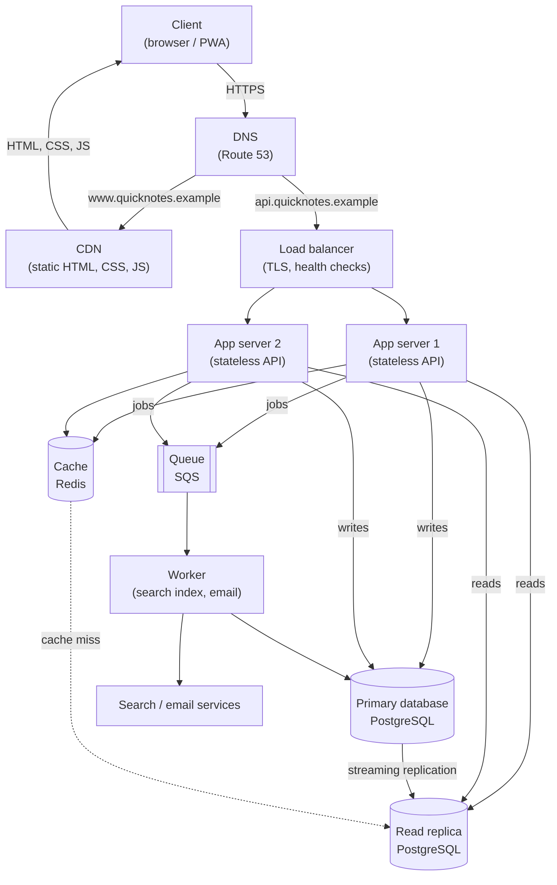

# QuickNotes Architecture

**Scope:** the production QuickNotes service for 1,000,000 registered users
**Related documents:** [API design](api-design.md) · [Data model](data-model.md)

This document explains how QuickNotes moves from a browser-only page to a real
service. It lists requirements, estimates load, shows the deployment architecture,
walks through the two most important requests and records the trade-offs behind the
design.

---

## 1. Context

QuickNotes is a small note-taking product. A user opens the web app, signs in, writes
short notes and organises them with tags. The browser client is deliberately thin: it
renders state, validates input and calls a JSON API. All durable state lives in the
backend, which must survive individual server, cache and database failures without
losing a note that the user was told was saved.

The design favours a **modular monolith** (one deployable API with clear modules for
auth, notes, tags and search) plus a small asynchronous worker. At 1 million users the
team does not need dozens of microservices; it needs independent scaling of web
requests and background work.

---

## 2. Functional requirements

| ID | Requirement |
| --- | --- |
| FR1 | A visitor can register with an email, display name and password. |
| FR2 | A registered user can log in and receive an access token; invalid credentials are rejected. |
| FR3 | An authenticated user can create a note with a required title (1–100 characters) and an optional body (up to 10,000 characters). |
| FR4 | A user can list their own notes, newest first, with pagination. |
| FR5 | A user can open, edit and delete one of their own notes. |
| FR6 | A user can create tags, attach several tags to a note and remove tags. |
| FR7 | A user can filter notes by tag and search title and body text. |
| FR8 | The browser shows loading, success, error and empty states for every API action. |
| FR9 | A user can never read or change another user's notes or tags. |
| FR10 | Deleting a note removes it from lists and search results. |

---

## 3. Non-functional requirements

| Category | Target | Why it matters |
| --- | --- | --- |
| Availability | **99.9%** monthly (≤ 43 min downtime) for the API | Notes should be reachable whenever a user wants to capture one. |
| Latency | p95 **≤ 300 ms** for reads, **≤ 500 ms** for writes, measured at the load balancer | The UI must feel immediate; slow saves cause duplicate submissions. |
| Throughput | At least **100 reads/s** and **10 writes/s** at peak with headroom for 2× growth | Derived in section 4. |
| Scalability | Support 1M registered users; scale web and worker tiers horizontally | Capacity must grow without a redesign. |
| Durability | RPO ≤ 5 minutes, RTO ≤ 30 minutes; daily backups with point-in-time recovery | A confirmed note must not disappear. |
| Consistency | Read-your-writes for a user's own notes; eventual consistency for search and analytics is acceptable | Users must see a note immediately after creating it. |
| Security | TLS 1.2+ everywhere, Argon2id password hashes, short-lived tokens, least-privilege database users, OWASP Top 10 controls | Notes are private. |
| Observability | Metrics, structured logs and traces with a request id; alerts on error rate, latency and queue age | Failures must be detectable before users report them. |
| Accessibility | WCAG 2.1 AA for the client, keyboard-operable controls, live status messages | The product should be usable by everyone. |
| Maintainability | CI/CD, infrastructure as code, automated migrations and rollback | A small team must operate the system safely. |
| Cost | Managed services where they remove operational risk; horizontal scale only when needed | Spend should follow usage. |

---

## 4. Load estimate for 1,000,000 users

### Assumptions

* 1,000,000 registered users.
* 10% are daily active users (DAU) = **100,000**.
* Each active user reads notes **20 times per day** and writes **2 notes per day**.
* Traffic peaks at **4×** the daily average, concentrated in the evening.
* The average note is **1 KB** on disk (title, body, row overhead).
* A 90% cache hit rate for note reads; the remaining 10% reach the database.

### Reads per second

```
2,000,000 reads/day ÷ 86,400 s/day = 23.1 reads/s average
23.1 × 4 = 92.6 reads/s peak  →  plan for 100 reads/s
```

After the cache, the database sees about **2–3 reads/s average and ~10 reads/s peak**.
The cache absorbs the repeat visits to the first page of notes.

### Writes per second

```
200,000 writes/day ÷ 86,400 s/day = 2.3 writes/s average
2.3 × 4 = 9.3 writes/s peak  →  plan for 10 writes/s
```

The write rate is low because creating a note is a deliberate action. The primary
database is comfortably sized for this load; the design keeps room for bursts such as
a marketing campaign or a client retry storm.

### Storage per year

```
200,000 notes/day × 1 KB          = 200 MB/day
200 MB/day × 365 days             = 73,000 MB ≈ 73 GB/year (raw note data)
+ ~30% indexes                    ≈ 22 GB
+ ~20% tags and note_tags         ≈ 15 GB
                                 ≈ 110 GB/year
+ WAL, backups and 2× safety headroom ≈ 220 GB/year provisioned
```

**Result:**

| Metric | Average | Peak (4×) | Provisioned |
| --- | --- | --- | --- |
| Reads | 23 reads/s | 93 reads/s | 100 reads/s |
| Writes | 2.3 writes/s | 9.3 writes/s | 10 writes/s |
| Storage | – | – | ~220 GB in year 1 (primary + indexes + backups); ~250 GB with headroom |

The read replica holds a full copy of the data, and backups are stored separately, so
the total infrastructure footprint is roughly double the primary figure. The estimate
still fits comfortably on a single well-sized PostgreSQL primary; the replica exists
for read scale and failover, not because the write volume requires sharding.

---

## 5. Architecture diagram



The same topology can be read as a layered list:

```
Client
  └─ DNS
      ├─ CDN  → static assets
      └─ Load balancer
          ├─ App server 1 ─┐
          └─ App server 2 ─┼─ Cache (Redis)
                           ├─ Primary DB ──replication──→ Read replica
                           └─ Queue (SQS) → Worker → search / email
```

Two app servers sit behind the load balancer in different availability zones. The
diagram shows two; the autoscaling group runs at least two at all times and adds more
when CPU or request latency crosses its target.

---

## 6. Components and the problem each solves

| Component | Problem it solves |
| --- | --- |
| **Client** | Renders the note list and form, validates input before sending it, and shows loading, success, error and empty states so the user always knows what happened. |
| **DNS** | Maps the human-friendly `quicknotes.example` names to the CDN for static files and to the load balancer for API traffic, and enables failover between healthy endpoints. |
| **CDN** | Serves HTML, CSS and JavaScript from points of presence close to users, cutting latency and removing static traffic from the API tier. |
| **Load balancer** | Terminates TLS, spreads requests across healthy app servers, drains connections during deploys and reroutes traffic when an app server fails health checks. |
| **App server 1 and App server 2** | Run the stateless API: authenticate requests, validate input, enforce ownership, read through the cache and database, and publish background jobs; running two or more across zones means one loss does not take the API down. |
| **Cache (Redis)** | Stores hot note pages and sessions so repeated reads avoid the database, reducing p95 latency and shielding the primary during traffic spikes. |
| **Primary database (PostgreSQL)** | Is the source of truth for users, notes, tags and tag links; it provides transactions, unique constraints and cascading deletes that keep the data correct. |
| **Read replica** | Serves list, detail and search reads from a continuously updated copy, so read traffic scales without loading the primary and the replica can be promoted during a primary failure. |
| **Queue (SQS)** | Buffers side effects such as search indexing and notification emails, so a slow worker or external service cannot delay the user's save response. |
| **Worker** | Consumes queue messages, updates the search index and sends email; it can be scaled independently and retries failed jobs with a dead-letter queue. |
| **Search / email services** | Provide full-text search and transactional email so the core API does not have to implement or operate those capabilities itself. |

---

## 7. Request flows

### 7.1 `GET /notes` — load the ten newest notes

1. The browser resolves `api.quicknotes.example` through DNS; the record points at the
   load balancer (recursive resolvers and the browser cache the answer).
2. The client sends `GET /v1/notes?limit=10` with `Authorization: Bearer <token>` over
   HTTPS. The UI immediately shows **"Loading notes..."** and disables action buttons.
3. The load balancer terminates TLS, checks backend health and forwards the request to
   a healthy app server.
4. The auth middleware verifies the token signature and expiry, then extracts
   `user_id`. A missing or invalid token returns **401** at this point.
5. The notes module builds a cache key such as `notes:user:7:page:1:limit:10` and asks
   Redis for it.
6. **Cache hit:** the serialized page is returned; the database is not touched.
7. **Cache miss:** the app queries the read replica with
   `WHERE user_id = 7 ORDER BY created_at DESC, id DESC LIMIT 10`, using
   `idx_notes_user_created`. If the user has just written a note and replica lag
   matters, the app reads that user's first page from the primary instead.
8. The app writes the result to Redis with a short TTL (60 seconds) and an
   invalidation tag for that user, then returns **200 OK** with the JSON body and
   `X-Request-Id`.
9. The load balancer returns the response. The browser renders each note with
   `textContent`, replaces the loading message with **"Loaded 10 notes from the
   server."**, and re-enables the buttons.
10. If the body is an empty array, the client renders the empty-state list item. If the
    request fails, it shows a friendly error and re-enables the buttons.

### 7.2 `POST /notes` — create a note

1. DNS, TLS and load balancing work exactly as in the read flow.
2. The auth middleware validates the bearer token and resolves `user_id`.
3. The notes module parses the JSON body and validates it: `title` is required after
   trimming, 1–100 characters; `body` is optional and at most 10,000 characters.
   Invalid input returns **400** with a validation error envelope, and the client
   shows the message without clearing the form.
4. The app verifies that any supplied tag ids or names belong to `user_id`; a tag that
   belongs to another user returns **403/422**.
5. The app opens a transaction on the **primary** database and inserts the note
   (`INSERT ... RETURNING id, created_at`), then inserts or reuses the tag rows and
   inserts the `note_tags` links. It commits only after every row succeeds.
6. On commit, the app invalidates the user's cached first pages and enqueues a
   `note.created` job on the queue. The job carries the note id and a request id.
7. The app returns **201 Created** with the new note and a `Location: /v1/notes/{id}`
   header. The user is not kept waiting for search indexing or email.
8. The worker consumes the job, updates the search index and sends any configured
   notifications. Failures are retried with exponential backoff; persistent failures go
   to a dead-letter queue for inspection.
9. The browser prepends the returned note to the list, clears the form and shows
   **"Note created (status 201, id 42)."**. The submit button is re-enabled in a
   `finally` block whether the request succeeded or failed.
10. A subsequent `GET /notes` may hit the primary (read-your-writes) or a replica that
    has caught up, so the new note is visible immediately.

---

## 8. Trade-offs

| Decision | Benefit | Cost / risk | How the design handles the cost |
| --- | --- | --- | --- |
| **Relational PostgreSQL instead of a document store** | Foreign keys, transactions, unique tags and many-to-many joins keep private data correct. | A single primary is harder to scale for writes than a sharded NoSQL store. | Current peak is only ~10 writes/s; use a bigger primary, then partition by `user_id` or move cold notes to an archive if growth demands it. Revisit only at much higher write volume. |
| **Asynchronous read replica** | Read traffic scales independently and the replica can take over if the primary fails. | Replication lag can show a user a stale list immediately after a write. | Route a user's first page after a write, and all writes, to the primary; use short cache TTLs and monitor lag; the UI treats reads as eventually consistent. |
| **Cache-aside Redis** | Cuts database reads by ~90% and keeps p95 latency low. | Cached pages can be stale, and Redis is another component to operate. | Invalidate the user's keys on every create/update/delete; use short TTLs; on Redis failure the app falls back to the replica instead of failing the request. |
| **Synchronous database commit, asynchronous side effects** | The user gets a durable confirmation as soon as the note is stored; search and email cannot block the save. | Search results and notifications are briefly behind the note. | The queue retries with backoff and a DLQ; the UI reads notes from the database, not the search index, so the note appears immediately. |
| **Modular monolith plus one worker** | Simple deploys, one database transaction boundary, low operational overhead for a small team. | Cannot scale modules independently or isolate a noisy module. | Stateless app servers scale horizontally; extract search or notifications into a service only when their load justifies it. |

---

## 9. Avoiding single points of failure

| Component | Failure mode | Mitigation |
| --- | --- | --- |
| **DNS** | The DNS provider or a record is unavailable. | Managed DNS with multiple name servers across zones; low TTL for failover records; keep the zone configuration in infrastructure as code; a secondary DNS provider can be added for critical uptime. |
| **CDN** | An edge location or the CDN account fails. | The CDN has many points of presence and automatic origin failover; static assets are versioned so a stale edge can be purged or bypassed. |
| **Load balancer** | The balancer or an availability zone fails. | Use a managed load balancer that is itself replicated across availability zones; health checks remove unhealthy targets; DNS can point at a standby balancer. |
| **App servers** | One instance crashes, runs out of memory or is being deployed. | Run at least two stateless instances in different availability zones; autoscaling replaces unhealthy instances; the load balancer drains connections; no session state is stored locally (tokens are self-contained). |
| **Cache** | Redis node loss or eviction storm. | Run a replicated Redis cluster with automatic failover; the app treats the cache as optional and falls back to the read replica; TTLs and a bounded key space limit memory pressure. |
| **Queue** | The broker or a consumer fails. | Use a managed queue replicated across zones; workers are idempotent, acknowledge only after success and retry with backoff; a dead-letter queue preserves poison messages. |
| **Primary database** | Instance, disk or availability-zone failure. | Multi-AZ primary with a synchronous standby and automatic failover; daily backups plus point-in-time recovery; connection retries; the read replica can be promoted as a last resort. The failover window is the one unavoidable short write interruption, kept to minutes by the managed service. |
| **Read replica** | Replica lags or dies. | Traffic shifts to the primary (with reduced capacity) or to another replica; lag alarms fire before users notice; the replica can be rebuilt from a snapshot. |
| **Worker** | A job crashes or an external service is down. | Run multiple workers; jobs are retried with exponential backoff and expire into a DLQ; the API never depends on a worker finishing for a successful save. |
| **Search / email provider** | Third-party outage. | Failures stay in the queue for retry; core note CRUD is unaffected; a fallback provider or a database search query can cover basic search. |

The guiding rule is that **no user-facing request depends on a single instance**. The
only true single-writer is the PostgreSQL primary, and it is protected by
synchronous Multi-AZ failover, backups and a documented recovery path.

---

## 10. Security and operations summary

* All external traffic uses HTTPS; the load balancer redirects HTTP to HTTPS.
* Passwords are hashed with Argon2id; tokens are short-lived and validated on every
  request; the database user for the API has only the privileges it needs.
* Rate limiting at the load balancer and in the app protects login and write endpoints.
* Metrics (request rate, error rate, p95 latency, cache hit ratio, replica lag, queue
  age) feed dashboards and alerts; logs carry `X-Request-Id` for tracing.
* Deploys are rolling with health checks and a tested rollback; migrations are
  backward-compatible and run before the new code is fully rolled out.
* Backups are encrypted, tested by restore drills, and stored outside the primary's
  failure domain.

---

## 11. Future scaling path

If usage outgrows this design, the next steps are, in order:

1. Add more read replicas and route search traffic separately.
2. Partition `notes` and `note_tags` by `user_id` (or move older notes to cold storage).
3. Extract search indexing and notifications into dedicated services.
4. Add a CDN cache for authenticated API reads where privacy allows.
5. Introduce sharding only when write throughput or storage exceeds what a primary and
   its replicas can handle.

These steps do not change the API contract or the browser client, which is why the API
design keeps pagination, stable error codes and resource-oriented paths.
