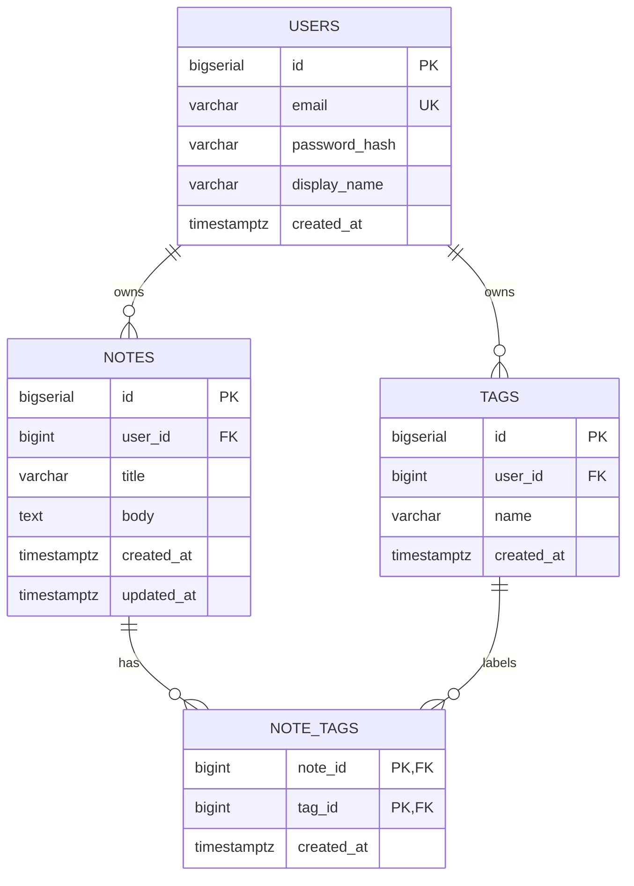

# QuickNotes Data Model

**Target database:** PostgreSQL 16
**Related documents:** [API design](api-design.md) · [Architecture](architecture.md)

This document defines the persistent data model for QuickNotes. Four entities are
needed for v1: `users`, `notes`, `tags` and `note_tags`. The schema is normalised so
that ownership, deletion and tag reuse are enforced by the database rather than by
application code alone.

---

## 1. Design assumptions

* One user owns many notes. A note has exactly one owner and cannot be shared in v1.
* Tags are private to a user. Two different users may both have a tag called `work`.
* A note may have zero or many tags; a tag may be attached to many notes. This is a
  many-to-many relationship, so it needs the `note_tags` join table.
* Deleting a user removes that user's notes and tags. Deleting a note removes its
  tag links but keeps the user's tag definitions.
* All timestamps are stored in UTC using `TIMESTAMPTZ`.
* IDs are 64-bit integers generated by the database (`BIGSERIAL`).
* Hard deletes are used in v1. If an audit trail is required later, add
  `deleted_at TIMESTAMPTZ` and a partial index instead of removing rows.

---

## 2. Entities and columns

### 2.1 `users`

| Column | Type | Constraints | Notes |
| --- | --- | --- | --- |
| `id` | `BIGSERIAL` | **PK** | Surrogate key used by every foreign key. |
| `email` | `VARCHAR(255)` | `NOT NULL`, `UNIQUE` | Login identifier; stored lowercase. |
| `password_hash` | `VARCHAR(255)` | `NOT NULL` | Argon2id hash; never the plain password. |
| `display_name` | `VARCHAR(100)` | `NOT NULL` | Shown in the UI. |
| `created_at` | `TIMESTAMPTZ` | `NOT NULL`, default `now()` | Account creation time. |
| `updated_at` | `TIMESTAMPTZ` | `NOT NULL`, default `now()` | Updated by the application on change. |

### 2.2 `notes`

| Column | Type | Constraints | Notes |
| --- | --- | --- | --- |
| `id` | `BIGSERIAL` | **PK** | Note id used in URLs. |
| `user_id` | `BIGINT` | `NOT NULL`, **FK → `users.id`** | Owner. Cascades on user delete. |
| `title` | `VARCHAR(100)` | `NOT NULL`, check 1–100 chars | Required, matching API validation. |
| `body` | `TEXT` | `NULL`, check ≤ 10,000 chars | Optional. |
| `created_at` | `TIMESTAMPTZ` | `NOT NULL`, default `now()` | Sort key for the notes list. |
| `updated_at` | `TIMESTAMPTZ` | `NOT NULL`, default `now()` | Last edit time. |

### 2.3 `tags`

| Column | Type | Constraints | Notes |
| --- | --- | --- | --- |
| `id` | `BIGSERIAL` | **PK** | Tag id. |
| `user_id` | `BIGINT` | `NOT NULL`, **FK → `users.id`**, part of `UNIQUE (user_id, name)` | Tags are per-user. |
| `name` | `VARCHAR(50)` | `NOT NULL`, part of `UNIQUE (user_id, name)` | Lowercased by the application. |
| `created_at` | `TIMESTAMPTZ` | `NOT NULL`, default `now()` | Creation time. |

### 2.4 `note_tags`

| Column | Type | Constraints | Notes |
| --- | --- | --- | --- |
| `note_id` | `BIGINT` | **PK (composite)**, **FK → `notes.id`** | Cascades on note delete. |
| `tag_id` | `BIGINT` | **PK (composite)**, **FK → `tags.id`** | Cascades on tag delete. |
| `created_at` | `TIMESTAMPTZ` | `NOT NULL`, default `now()` | When the tag was attached. |

The composite primary key `(note_id, tag_id)` makes duplicate attachments impossible
and supplies the index needed to fetch a note's tags.

---

## 3. Relationships

### One-to-many: users → notes

`notes.user_id` is a non-null foreign key to `users.id`. A user can own any number of
notes, but every note has exactly one owner. This supports the API rule that all note
queries are filtered by the authenticated user's id. `ON DELETE CASCADE` means deleting
an account cannot leave orphaned notes.

### One-to-many: users → tags

`tags.user_id` scopes tag names to a user. Without it, one user creating `work` would
block every other user from using that name. Deleting a user cascades to their tags.

### Many-to-many: notes ↔ tags through `note_tags`

A note can carry several tags, and one tag can label many notes. Neither table can hold
a foreign key to the other without duplication, so `note_tags` stores one row per
pairing. Its composite primary key enforces uniqueness, and both foreign keys cascade
so deleting a note or a tag cleans up the links automatically.

The model does not add a database constraint that a note and its tag must belong to the
same user, because that would require carrying `user_id` through the join table. The
create-note transaction checks ownership in application code, and an optional deferred
trigger can enforce it if the API grows additional writers.



---

## 4. CREATE TABLE statements

Run the statements in this order so foreign-key targets exist first.

```sql
-- 1. Accounts
CREATE TABLE users (
    id            BIGSERIAL PRIMARY KEY,
    email         VARCHAR(255) NOT NULL,
    password_hash VARCHAR(255) NOT NULL,
    display_name  VARCHAR(100) NOT NULL,
    created_at    TIMESTAMPTZ  NOT NULL DEFAULT now(),
    updated_at    TIMESTAMPTZ  NOT NULL DEFAULT now(),
    CONSTRAINT users_email_unique UNIQUE (email),
    CONSTRAINT users_email_lowercase CHECK (email = lower(email))
);

-- 2. Notes owned by a user
CREATE TABLE notes (
    id         BIGSERIAL PRIMARY KEY,
    user_id    BIGINT       NOT NULL,
    title      VARCHAR(100) NOT NULL,
    body       TEXT,
    created_at TIMESTAMPTZ  NOT NULL DEFAULT now(),
    updated_at TIMESTAMPTZ  NOT NULL DEFAULT now(),
    CONSTRAINT notes_user_fk
        FOREIGN KEY (user_id) REFERENCES users (id) ON DELETE CASCADE,
    CONSTRAINT notes_title_length
        CHECK (length(btrim(title)) BETWEEN 1 AND 100),
    CONSTRAINT notes_body_length
        CHECK (body IS NULL OR length(body) <= 10000)
);

-- 3. Per-user tag dictionary
CREATE TABLE tags (
    id         BIGSERIAL PRIMARY KEY,
    user_id    BIGINT      NOT NULL,
    name       VARCHAR(50) NOT NULL,
    created_at TIMESTAMPTZ NOT NULL DEFAULT now(),
    CONSTRAINT tags_user_fk
        FOREIGN KEY (user_id) REFERENCES users (id) ON DELETE CASCADE,
    CONSTRAINT tags_user_name_unique UNIQUE (user_id, name),
    CONSTRAINT tags_name_length
        CHECK (length(btrim(name)) BETWEEN 1 AND 50)
);

-- 4. Join table for the many-to-many relationship
CREATE TABLE note_tags (
    note_id    BIGINT      NOT NULL,
    tag_id     BIGINT      NOT NULL,
    created_at TIMESTAMPTZ NOT NULL DEFAULT now(),
    PRIMARY KEY (note_id, tag_id),
    CONSTRAINT note_tags_note_fk
        FOREIGN KEY (note_id) REFERENCES notes (id) ON DELETE CASCADE,
    CONSTRAINT note_tags_tag_fk
        FOREIGN KEY (tag_id) REFERENCES tags (id) ON DELETE CASCADE
);
```

The application sets `updated_at = now()` on updates. `users.email` must be lowercased
before insert so the `users_email_lowercase` check and the unique index behave
consistently. Tag names are lowercased by the API for the same reason.

---

## 5. Indexes and why they exist

Primary keys and `UNIQUE` constraints create indexes automatically:

| Index | Definition | Reason |
| --- | --- | --- |
| `users_pkey` | PK on `users(id)` | Foreign-key lookups and session resolution. |
| `users_email_unique` | Unique on `users(email)` | Login is a single indexed lookup; also prevents duplicate accounts. |
| `notes_pkey` | PK on `notes(id)` | Fetch, update and delete one note. |
| `tags_user_name_unique` | Unique on `tags(user_id, name)` | Prevents duplicate tags per user and speeds up "find or create tag". |
| `note_tags_pkey` | PK on `note_tags(note_id, tag_id)` | Prevents duplicate links; fetches a note's tags quickly. |

Additional indexes created explicitly:

```sql
-- The main notes-list query: one user's notes, newest first, keyset-friendly.
CREATE INDEX idx_notes_user_created
    ON notes (user_id, created_at DESC, id DESC);

-- Full-text search across title and body for GET /notes?q=...
CREATE INDEX idx_notes_search
    ON notes USING GIN (
        to_tsvector('english', title || ' ' || coalesce(body, ''))
    );

-- Reverse lookup: which notes use this tag? The PK starts with note_id, so it
-- cannot serve queries filtered by tag_id alone.
CREATE INDEX idx_note_tags_tag_id
    ON note_tags (tag_id);
```

**Main index reasoning:** `idx_notes_user_created` matches the dominant query
(`WHERE user_id = ? ORDER BY created_at DESC, id DESC LIMIT 10`) exactly. The database
can descend the B-tree to the user's newest row and read ten rows without sorting the
user's whole collection. Including `id DESC` makes the ordering deterministic when two
notes share a timestamp and supports keyset pagination later.

---

## 6. Example SQL queries

### 6.1 List one user's ten newest notes

```sql
SELECT id, title, body, created_at, updated_at
FROM notes
WHERE user_id = $1
ORDER BY created_at DESC, id DESC
LIMIT 10 OFFSET 0;
```

Uses `idx_notes_user_created`; no sequential scan and no sort for the common page.

### 6.2 Create a note

```sql
INSERT INTO notes (user_id, title, body)
VALUES ($1, $2, $3)
RETURNING id, user_id, title, body, created_at, updated_at;
```

`RETURNING` gives the API the generated id and timestamps without a second query.

### 6.3 List notes with their tags (JOIN)

```sql
SELECT
    n.id,
    n.title,
    n.body,
    n.created_at,
    coalesce(
        array_agg(t.name ORDER BY t.name) FILTER (WHERE t.id IS NOT NULL),
        '{}'
    ) AS tags
FROM notes n
LEFT JOIN note_tags nt ON nt.note_id = n.id
LEFT JOIN tags t       ON t.id = nt.tag_id
WHERE n.user_id = $1
GROUP BY n.id
ORDER BY n.created_at DESC, n.id DESC
LIMIT 10;
```

A `LEFT JOIN` keeps untagged notes in the result. PostgreSQL allows grouping by the
primary key `n.id` while selecting the other `notes` columns.

### 6.4 Filter notes by tag

```sql
SELECT n.id, n.title, n.created_at
FROM notes n
JOIN note_tags nt ON nt.note_id = n.id
JOIN tags t       ON t.id = nt.tag_id
WHERE n.user_id = $1
  AND t.name = $2
ORDER BY n.created_at DESC, n.id DESC
LIMIT 10;
```

The join starts from the tag name and uses `idx_note_tags_tag_id` for the reverse
direction when the planner chooses it.

### 6.5 Full-text search

```sql
SELECT id, title, created_at
FROM notes
WHERE user_id = $1
  AND to_tsvector('english', title || ' ' || coalesce(body, ''))
      @@ plainto_tsquery('english', $2)
ORDER BY created_at DESC
LIMIT 10;
```

The `idx_notes_search` GIN index makes this a search-index lookup instead of a scan of
all of the user's notes.

### 6.6 Attach a tag safely

```sql
INSERT INTO note_tags (note_id, tag_id)
VALUES ($1, $2)
ON CONFLICT (note_id, tag_id) DO NOTHING;
```

Attaching an existing tag is idempotent, matching the API design.

---

## 7. Transactions and ownership

Creating a note with tags is one transaction:

1. Verify the note id and every tag id belong to the authenticated user.
2. `INSERT` the note.
3. For each tag name, `INSERT ... ON CONFLICT (user_id, name) DO UPDATE SET name =
   EXCLUDED.name RETURNING id` (the no-op update lets PostgreSQL return the existing
   row's id).
4. `INSERT` the `note_tags` rows.
5. Commit.

If any step fails, the transaction rolls back. Reads can be served by a replica, but
ownership checks and writes go to the primary so a user immediately sees their own
change.

---

## 8. SQL or NoSQL?

**QuickNotes uses a relational database (PostgreSQL).** The core data is highly
structured and strongly related: a note must have an owner, a tag must be unique per
user, and deleting data must not leave orphaned join rows. Foreign keys, `ON DELETE
CASCADE`, unique constraints and multi-row transactions express those rules directly
and protect the data even if a future service writes to the same tables. The
many-to-many tag feature is a natural fit for a join table, and the API needs flexible
ad-hoc queries such as "this user's notes, newest first, filtered by tag and search
text", which are simple in SQL. At the projected scale (roughly 100 reads/second at
peak and 10 writes/second at peak, with about 150 GB of storage per year) a single
primary with a read replica, a Redis cache and future partitioning by `user_id` is
comfortable; the team does not need the write throughput of a wide-column store.
A document database such as MongoDB or DynamoDB would make each note self-contained and
horizontally scalable for writes, but tag filtering would require duplicated arrays or
extra indexes, cross-entity rules would move into application code, and reporting would
be harder. PostgreSQL also offers `JSONB` for future flexible metadata, so the team can
add schemaless fields without changing databases. NoSQL would become attractive only if
write volume grew by orders of magnitude or notes became large, independently versioned
documents.
